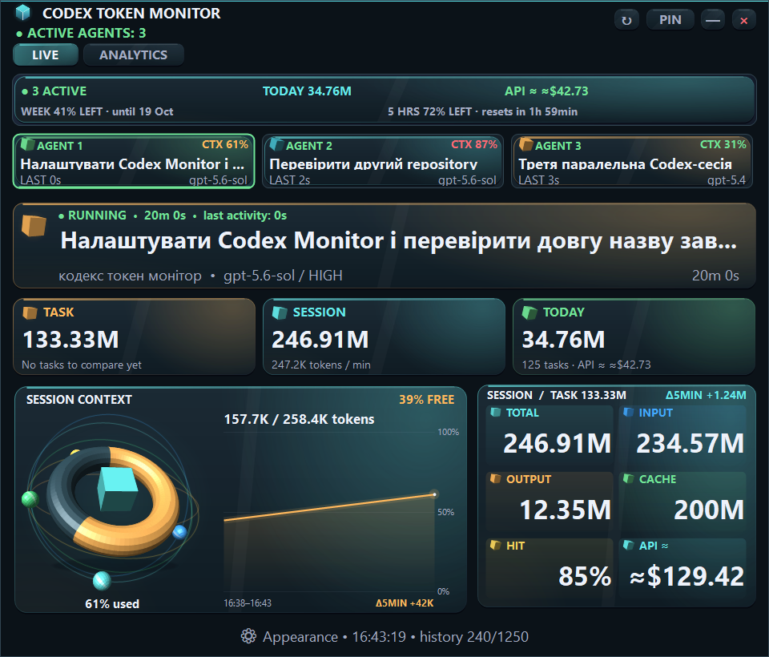
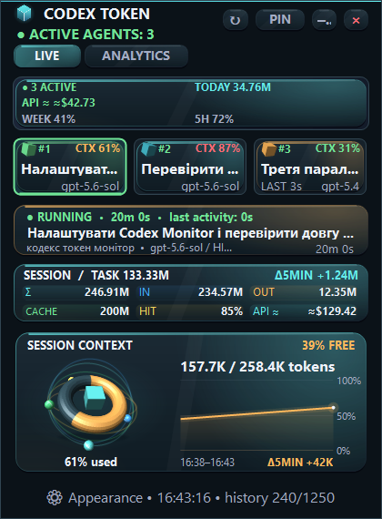
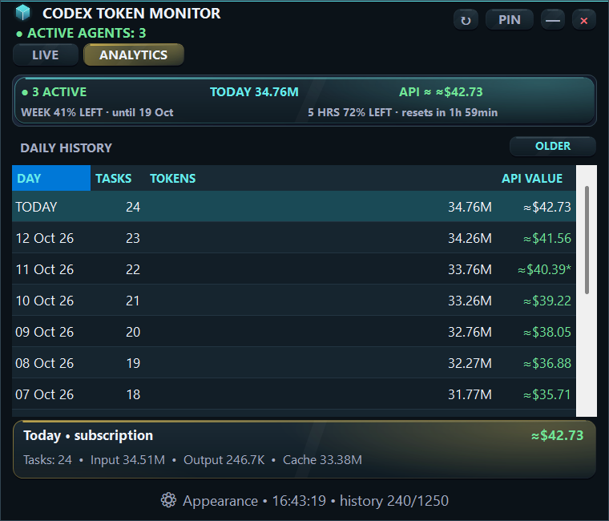

<p align="center"></p>
<h1 align="center">Codex Token Monitor</h1>
<p align="center"><strong>English</strong> | <a href="README.uk.md">Українська</a></p>
<p align="center">
  <a href="LICENSE"></a>
  <a href="https://github.com/Valerii-S84/codex-token-monitor/actions/workflows/windows-ci.yml"></a>
</p>
<p align="center">Active agents, tokens, context, and daily Codex analytics in one Windows window.</p>
<p align="center"><strong>One EXE · Local data · No API key</strong></p>
<p align="center"><a href="#start">Quick start</a> · <a href="#screenshots">Screenshots</a> · <a href="#autostart">Autostart</a> · <a href="#development">Build and test</a></p>
<p align="center"></p>
<p align="center"><sub>Version 2.1.0 supports Ukrainian and English. Screenshots use demonstration data from render tests.</sub></p>

Current release: **[v2.1.0](https://github.com/Valerii-S84/codex-token-monitor/releases/tag/v2.1.0)**. Download the EXE from Releases; the repository contains source code and documentation.

## What the monitor shows

Codex Token Monitor reads local Codex JSONL logs. It displays several agents, token usage, and daily statistics without calling the OpenAI API.

| Feature | What you see |
|---|---|
| **Parallel agents** | Separate cards for active sessions, task names, and repositories |
| **Tokens** | Current task, session, and daily totals; input, output, and cached tokens |
| **Context** | Selected session's context window usage and its history |
| **Analytics** | Daily token and task totals, with an approximate API equivalent |
| **Appearance** | Compact and expanded layouts, palettes, animation, and always-on-top mode |
| **Language** | Complete Ukrainian / English interface; immediate switching and saved preference |
| **Autostart** | A local extension starts the monitor with VS Code |

The monitor reads logs incrementally and remembers window position and size. Starting it again does not create another instance.

Choose **Appearance → Language → Українська / English** to switch without restarting. The selected agent, tab, window size, and chart history are preserved. Existing installations keep Ukrainian until you select another language. New installations use Ukrainian on Ukrainian Windows and English elsewhere. Dates and durations follow the selected language; original task, repository, and model names stay unchanged. Both translations are embedded in the EXE.

Click **⚙ Appearance at the bottom of the window**, then **Language**. You can also open this menu by right-clicking the context chart.

<a id="start"></a>

## Quick start

1. Download [CodexTokenMonitor.exe](https://github.com/Valerii-S84/codex-token-monitor/releases/latest/download/CodexTokenMonitor.exe) from the [latest Release](https://github.com/Valerii-S84/codex-token-monitor/releases/latest).
2. Compare its SHA-256 with `SHA256SUMS.txt` from the same Release:

   ```powershell
   Get-FileHash .\CodexTokenMonitor.exe -Algorithm SHA256
   ```

3. Run the EXE. No separate installer is needed.
4. The monitor discovers your local Codex session logs and updates automatically.

**Requirements:** Windows 10 or 11, .NET Framework **4.8 or later**, and Codex producing local session logs. No API key is needed. Windows Server is used for CI; desktop verification is performed on Windows 11. The first Release is unsigned; SHA-256 identifies the file but does not authenticate its publisher.

If logs are stored elsewhere:

```powershell
.\CodexTokenMonitor.exe --codex-home "D:\CodexData"
```

Development commands run from the repository root. Downloaded files can be placed in any folder; configure the EXE path when using autostart.

<a id="screenshots"></a>

## Screenshots

### Compact view

A window beside your editor showing active agents, tokens, and the selected session's context.

<p align="center"><a href="docs/screenshots/live-compact.en.png"></a></p>

### Daily analytics

The **ANALYTICS** tab shows totals for indexed days. **OLDER** loads more logs.

<p align="center"><a href="docs/screenshots/analytics.en.png"></a></p>

These images show real application controls. Numbers, tasks, and sessions are demonstration data.

## Controls

| Action | Control |
|---|---|
| Refresh | `↻` button |
| Select an agent | Agent card or session navigation buttons |
| Open daily statistics | **ANALYTICS** tab |
| Keep the window on top | Pin button in the top bar |
| Change appearance | **Appearance** at the bottom |
| Switch language | **Appearance → Language → Українська / English** |
| Switch layout | `Ctrl+1`, `Ctrl+2`, `Ctrl+3` |
| Toggle animation | `Ctrl+M` |

Drag the unused top area to move the window. Resize it using its edges or corners. Position and appearance preferences persist between launches.

## Reading the metrics

| Metric | Meaning |
|---|---|
| **Завдання / Task** | Tokens for the current or last task in the selected session |
| **Сесія / Session** | Total tokens for the selected Codex session |
| **Сьогодні / Today** | All indexed sessions for the current local day |
| **Вхід / Input** | Input tokens, including cached tokens |
| **Вихід / Output** | Model output tokens |
| **Кеш / Cached** | The cached portion of input tokens |
| **API ≈ / API VALUE** | Approximate API equivalent using the embedded rate catalog |

`Cached` is included in `Input` and is not counted twice. Reasoning tokens are not added to cost on top of `Output`.

**The API equivalent is not your Codex subscription bill or remaining subscription allowance.** Rates are in [src/Pricing.cs](src/Pricing.cs). Standard short-context rates were checked on October 11, 2026; see the [catalog and sources](docs/API_PRICING.md). Long-context, Fast/Ultrafast, regional, and tool-call surcharges are excluded. Unknown models or unavailable rates make an estimate partial. It does not guarantee an actual API bill.

<a id="autostart"></a>

## Autostart with VS Code

The [local autostart extension](vscode-autostart/README.md), version **1.1.1**, launches the EXE after VS Code loads. It runs locally, including when your workspace is remote. It starts with VS Code, not with Windows.

Download the [VSIX](https://github.com/Valerii-S84/codex-token-monitor/releases/latest/download/codex-token-monitor-autostart-1.1.1.vsix) and verify its SHA-256 from the same Release. Install through **Extensions: Install from VSIX…**, or from the download folder:

```powershell
code --install-extension .\codex-token-monitor-autostart-1.1.1.vsix --force
```

Restart VS Code after installation. Set the executable path in VS Code's `settings.json`:

```json
{
  "codexTokenMonitor.executablePath": "C:/Tools/CodexTokenMonitor/CodexTokenMonitor.exe"
}
```

Replace the example with your own path. When empty, this setting searches the Desktop folders `Codex Token Monitor`, `codex-token-monitor`, and then `кодекс токен монітор`. For other locations, configure the path explicitly. Multiple VS Code windows do not create multiple monitor instances.

<a id="development"></a>

## Build and test

Use **Windows PowerShell 5.1** and .NET Framework 4.8 or later. The full gate also requires **Node.js 22 or later** for autostart tests. No external NuGet packages are used.

### Build

```powershell
powershell.exe -NoProfile -ExecutionPolicy Bypass -File .\scripts\build.ps1
```

This writes `artifacts/build/CodexTokenMonitor.exe`. Close a running copy before replacing it. To keep a development build separate from the verified release:

```powershell
powershell.exe -NoProfile -ExecutionPolicy Bypass -File .\scripts\build.ps1 -OutputPath ".\artifacts\build\development\CodexTokenMonitor.exe"
```

### Full verification

```powershell
powershell.exe -NoProfile -ExecutionPolicy Bypass -File .\scripts\test.ps1
```

The gate covers smoke, analytics, crash resilience, dashboard, multi-agent behavior, localization, settings migration, layouts, animation, and autostart. Success ends with `RELEASE_GATE_OK`.

Test scripts use temporary log and data directories and restore their process environment afterwards. Personal logs and settings are not used. All nine render scenarios run in both Ukrainian and English (18 cases), including `1240×900`. CI temporarily selects a supported `1280×1024` mode on its disposable GitHub-hosted runner. Local scripts never change your display mode.

```powershell
powershell.exe -NoProfile -ExecutionPolicy Bypass -File .\scripts\render-test.ps1
```

Images go to ignored `artifacts/renders/uk/` and `artifacts/renders/en/`. CI preserves available images even after failure. Selected README screenshots are stored in `docs/screenshots/`.

### Release builds

See [RELEASING.md](docs/RELEASING.md) for clean-commit builds, binary verification, SHA-256, and publication. Signing is optional for the first Release.

Optional signed production builds require a clean Git tree, a tag on `HEAD`, and a valid certificate with its private key:

```powershell
powershell.exe -NoProfile -ExecutionPolicy Bypass -File .\scripts\build.ps1 -Production -CodeSigningThumbprint "YOUR_CERTIFICATE_THUMBPRINT"
```

## Privacy and local files

The monitor reads local logs, makes no network requests, and sends no telemetry. Original Codex logs remain unchanged.

Application data defaults to `%LOCALAPPDATA%\CodexTokenMonitor`:

| File | Purpose |
|---|---|
| `settings.ini` | Window position, size, and pinning |
| `appearance.ini` | Language, layout, palette, and animation preferences |
| `session-cache-v9.bin` | Incremental session and token index |
| `errors.log` | Local error log |

Deleting the cache does not delete sessions; the next launch rebuilds the index. For isolated testing or a separate data directory, set `CODEX_TOKEN_MONITOR_DATA_HOME` for the process. Each explicit data directory has its own single instance. Leaving it unset preserves the normal location and single-instance behavior.

<details>
<summary><strong>How logs and session names are found</strong></summary>

Codex home candidates are checked in this order:

1. `--codex-home` or `--codex-home=...` argument.
2. `CODEX_HOME` environment variable.
3. `%USERPROFILE%\.codex`.
4. `%LOCALAPPDATA%\Codex`.
5. `%APPDATA%\Codex`.

At startup, the monitor requests the 240 newest logs in `sessions` and `archived_sessions`. **ДАВНІШІ** (Older) adds 120 more. Duplicate sessions use the most complete copy.

The repository is derived from `cwd` and the nearest `.git` directory. Task names come from `session_index.jsonl`, session events, or fallback names in `history.jsonl` and the repository name.

</details>

## Troubleshooting

| Situation | Check |
|---|---|
| `CODEX_HOME not found` | Confirm session logs exist; specify `--codex-home` |
| Incomplete analytics | Wait for indexing or click **ДАВНІШІ** (Older) |
| Partial API estimate | Check model and rates in `src/Pricing.cs` |
| Autostart does not work | Configure `codexTokenMonitor.executablePath` and restart VS Code |
| Build cannot replace EXE | Close the running copy or use another `-OutputPath` |

For issues, include Windows and application versions, reproduction steps, and error text. Remove private names and paths from screenshots and log excerpts.

## Repository layout

```text
README.md / README.uk.md English and Ukrainian documentation
LICENSE                 MIT license
src/                    source code
tests/                  regression tests and binary verifier
scripts/                build, test, and release scripts
resources/              DPI and Windows manifest
assets/                 icon and logo
docs/                   screenshots, pricing, and release instructions
vscode-autostart/        local extension, packaging, and tests
artifacts/              VSIX and ignored generated results
artifacts/build/        local EXE and release verification files (ignored by Git)
.github/workflows/      Windows CI
```

## License

[MIT](LICENSE). You may use, modify, distribute, and sell copies, including commercially, while retaining the copyright and license notices. The software is provided without warranty.

This is an independent project, not an official OpenAI product.

**Your sessions stay on your computer.**
