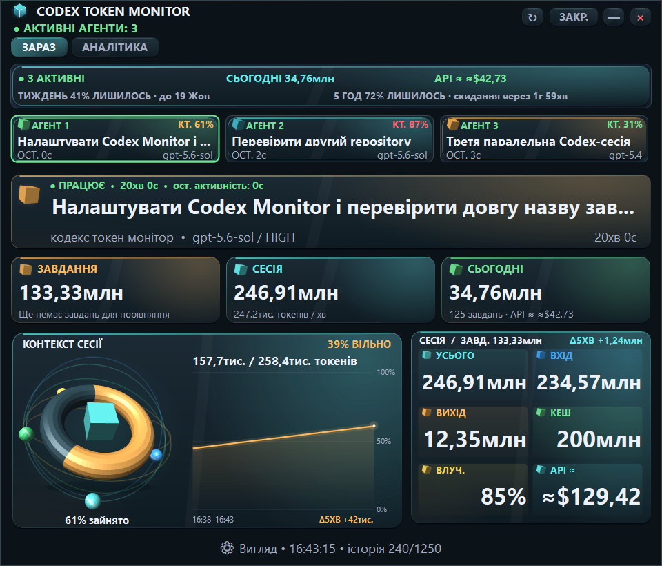
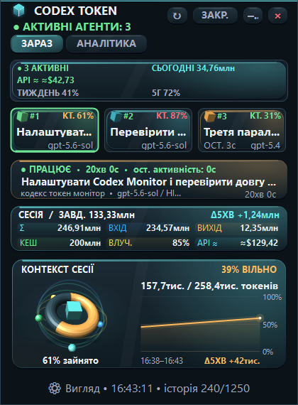
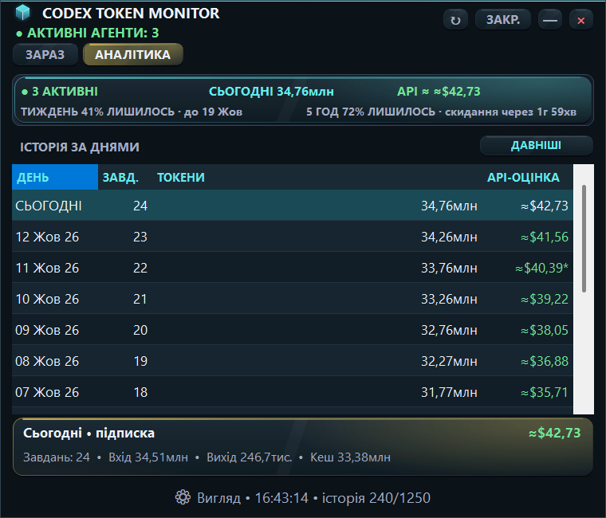

<p align="center">
  
</p>

<h1 align="center">Codex Token Monitor</h1>

<p align="center"><a href="README.md">English</a> | <strong>Українська</strong></p>

<p align="center">
  <a href="LICENSE"></a>
  <a href="https://github.com/Valerii-S84/codex-token-monitor/actions/workflows/windows-ci.yml"></a>
</p>

<p align="center">
  Активні агенти, токени, контекст і денна аналітика Codex — в одному вікні на Windows.
</p>

<p align="center">
  <strong>Один EXE · Локальні дані · Без API key</strong>
</p>

<p align="center">
  <a href="#start">Запуск</a> ·
  <a href="#screenshots">Скриншоти</a> ·
  <a href="#autostart">Автозапуск</a> ·
  <a href="#development">Збірка та перевірка</a>
</p>

<p align="center">
  
</p>

<p align="center"><sub>Версія 2.1.0 підтримує українську та англійську. Скриншоти містять демонстраційні дані з render-тестів.</sub></p>

## Що показує монітор

Codex Token Monitor читає локальні JSONL-журнали Codex. Він показує роботу кількох агентів, використані токени й статистику за днями без звернень до OpenAI API.

| Можливість | Що ви бачите |
|---|---|
| **Паралельні агенти** | Окремі картки активних сесій, назви завдань і репозиторії |
| **Токени** | Підсумки поточного завдання, сесії та дня; вхід, вихід і кеш |
| **Контекст** | Заповнення контекстного вікна вибраної сесії та графік змін |
| **Аналітика** | Статистика за днями, кількість завдань і приблизний API-еквівалент |
| **Вигляд** | Компактний і розгорнуті макети, палітри, анімація та закріплення поверх інших вікон |
| **Мова** | Повний український та англійський інтерфейс, миттєве перемикання і збереження вибору |
| **Автозапуск** | Локальне розширення запускає монітор разом із VS Code |

Монітор читає журнали інкрементально, запам’ятовує положення та розмір вікна. Повторний запуск не створює другого екземпляра.

Виберіть **«Вигляд → Мова → Українська / English»**, щоб перемкнути весь інтерфейс без перезапуску. Вибраний агент, вкладка, розмір вікна та історія графіка зберігаються. Наявні встановлення залишаються українською до вашого вибору. Нові встановлення використовують українську на українській Windows та англійську на інших. Дати й тривалість відповідають вибраній мові; назви ваших завдань, репозиторіїв і моделей залишаються оригінальними. Обидва переклади вбудовані в один EXE.

<a id="start"></a>

## Швидкий запуск

1. Завантажте [CodexTokenMonitor.exe](https://github.com/Valerii-S84/codex-token-monitor/releases/latest/download/CodexTokenMonitor.exe) з [останнього Release](https://github.com/Valerii-S84/codex-token-monitor/releases/latest).
2. Запустіть EXE. Окремий інсталятор для монітора не потрібен.
3. Монітор знайде локальні журнали Codex і почне оновлювати дані.

**Для запуску потрібні:** Windows 10 або 11, .NET Framework **4.8 або новіший** та Codex, який створює локальні журнали сесій. API key для монітора не потрібен. CI використовує Windows Server; перевірка на робочому столі виконується у Windows 11. Інтерфейс доступний українською та англійською.

Перший Release не має цифрового підпису. Звірте SHA-256 із `SHA256SUMS.txt` того самого Release; контрольна сума підтверджує відповідність файла, але не видавця:

```powershell
Get-FileHash .\CodexTokenMonitor.exe -Algorithm SHA256
```

Якщо журнали зберігаються в іншій папці:

```powershell
.\CodexTokenMonitor.exe --codex-home "D:\CodexData"
```

Команди в цьому README виконуються з кореня репозиторію.

<a id="screenshots"></a>

## Скриншоти

### Компактний режим

Вікно для роботи поруч із редактором: активні агенти, токени та контекст вибраної сесії.

<p align="center">
  <a href="docs/screenshots/live-compact.png">
    
  </a>
</p>

### Аналітика за днями

Вкладка **«АНАЛІТИКА»** показує підсумки за проіндексованими днями. Кнопка **«ДАВНІШІ»** завантажує додаткові журнали.

<p align="center">
  <a href="docs/screenshots/analytics.png">
    
  </a>
</p>

Усі зображення отримані з реальних контролів поточної версії. Числа, завдання й сесії на них демонстраційні.

## Керування

| Дія | Керування |
|---|---|
| Оновити дані | Кнопка `↻` |
| Вибрати агента | Картка агента або кнопки переходу між сесіями |
| Переглянути денну статистику | Вкладка **«АНАЛІТИКА»** |
| Закріпити вікно поверх інших | Кнопка закріплення у верхній панелі |
| Налаштувати вигляд | **«Вигляд»** у нижній частині вікна |
| Перемкнути макет | `Ctrl+1`, `Ctrl+2`, `Ctrl+3` |
| Увімкнути або призупинити анімацію | `Ctrl+M` |

Вікно можна перетягувати за верхню вільну область і змінювати його розмір за краї або кути. Налаштування вигляду та положення зберігаються між запусками.

## Як читати показники

| Показник | Значення |
|---|---|
| **Завдання** | Токени поточного або останнього завдання вибраної сесії |
| **Сесія** | Загальна кількість токенів вибраної Codex-сесії |
| **Сьогодні** | Підсумок усіх проіндексованих сесій за поточний локальний день |
| **Вхід / Input** | Вхідні токени, включно з кешованими |
| **Вихід / Output** | Вихідні токени моделі |
| **Кеш / Cached** | Кешована частина вхідних токенів |
| **API ≈ / API VALUE** | Орієнтовний API-еквівалент за вбудованим каталогом ставок |

`Cached` уже входить до `Input`; монітор не додає ці токени вдруге. Reasoning-токени не додаються до вартості поверх `Output`.

**API-еквівалент не є рахунком за підпискою Codex або залишком її ліміту.** Каталог моделей і ставок міститься у [src/Pricing.cs](src/Pricing.cs). Ставки Standard для короткого контексту звірено 11 жовтня 2026 року; [повний перелік і джерела](docs/API_PRICING.md). Надбавки за довгий контекст, Fast/Ultrafast, регіон та виклики інструментів не враховуються. Невідомі моделі та відсутні ставки позначають оцінку як часткову; значення не гарантує суму фактичного API-рахунку.

<a id="autostart"></a>

## Автозапуск із VS Code

У репозиторії є [локальне розширення автозапуску](vscode-autostart/README.md) версії **1.1.1**. Воно запускає EXE після завантаження VS Code та працює локально навіть для віддаленого workspace.

Завантажте [пакет автозапуску VSIX](https://github.com/Valerii-S84/codex-token-monitor/releases/latest/download/codex-token-monitor-autostart-1.1.1.vsix), звірте SHA-256 із того самого Release та встановіть його через **Extensions: Install from VSIX…** або з папки завантаження:

```powershell
code --install-extension .\codex-token-monitor-autostart-1.1.1.vsix --force
```

Також можна встановити VSIX через команду **Extensions: Install from VSIX…** у VS Code. Після встановлення перезапустіть VS Code.

Вкажіть розташування EXE у `settings.json` VS Code:

```json
{
  "codexTokenMonitor.executablePath": "C:/Tools/CodexTokenMonitor/CodexTokenMonitor.exe"
}
```

Замініть приклад своїм шляхом. Якщо налаштування порожнє, розширення шукає EXE на робочому столі послідовно в папках `Codex Token Monitor`, `codex-token-monitor` та `кодекс токен монітор`. Для іншої назви папки або розташування вкажіть актуальний `codexTokenMonitor.executablePath`. Кілька вікон VS Code не створюють кілька екземплярів монітора.

<a id="development"></a>

## Збірка та перевірка

Для роботи з кодом потрібні Windows PowerShell **5.1** і .NET Framework **4.8 або новіший**; повна брама також використовує Node.js **22 або новіший**. Зовнішні NuGet-пакети не використовуються.

### Збірка

```powershell
powershell.exe -NoProfile -ExecutionPolicy Bypass -File .\scripts\build.ps1
```

Результат — `CodexTokenMonitor.exe` у корені. Перед перезбиранням закрийте запущений монітор.

Для збірки в окрему папку:

```powershell
New-Item -ItemType Directory -Force .\artifacts\build | Out-Null
powershell.exe -NoProfile -ExecutionPolicy Bypass -File .\scripts\build.ps1 -OutputPath ".\artifacts\build\CodexTokenMonitor.exe"
```

### Повна перевірка

```powershell
powershell.exe -NoProfile -ExecutionPolicy Bypass -File .\scripts\test.ps1
```

Брама охоплює smoke- та Analytics-перевірки, стійкість до збоїв, панель показників, паралельні агенти, переклади, міграцію налаштувань, макети, анімацію та автозапуск. Успішний запуск завершується:

```text
RELEASE_GATE_OK
```

Render-тести входять до повної брами. Для окремого запуску:

```powershell
powershell.exe -NoProfile -ExecutionPolicy Bypass -File .\scripts\render-test.ps1
```

Контрольні зображення створюються в `artifacts/renders/uk/` і `artifacts/renders/en/` та ігноруються Git. Відібрані зображення для цього README зберігаються окремо в `docs/screenshots/`.

Тести використовують тимчасові журнали й папки даних та відновлюють змінні свого процесу після завершення. Особисті журнали та налаштування не використовуються. Усі дев’ять сценаріїв render-тестів, включно з `1240×900`, обов’язкові для кожної мови — разом 18 перевірок. CI тимчасово встановлює підтримуваний режим `1280×1024` лише на GitHub-hosted runner; локальні скрипти не змінюють екран. Доступні зображення CI зберігаються як artifacts навіть після помилки.

Процедура випуску: [RELEASING.md](docs/RELEASING.md). Для першого Release цифровий підпис необов’язковий; потрібні чистий коміт, перевірений EXE, узгоджена версія та SHA-256.

<details>
<summary><strong>Production-збірка з цифровим підписом</strong></summary>

Потрібні чисте робоче дерево Git, тег на `HEAD` і чинний сертифікат із приватним ключем:

```powershell
powershell.exe -NoProfile -ExecutionPolicy Bypass -File .\scripts\build.ps1 -Production -CodeSigningThumbprint "YOUR_CERTIFICATE_THUMBPRINT"
```

Скрипт створює підписаний EXE та `.release.json` із commit, тегом і SHA-256. Для звичайного локального запуску production-збірка не потрібна.

</details>

## Приватність і локальні файли

Монітор читає локальні журнали, не виконує мережевих запитів і не надсилає телеметрію. Оригінальні журнали Codex залишаються без змін.

Службові дані зберігаються у `%LOCALAPPDATA%\CodexTokenMonitor`:

Для ізольованого тестування або окремої папки даних можна задати `CODEX_TOKEN_MONITOR_DATA_HOME` для процесу. Кожна явно задана папка має свій єдиний екземпляр. Без цієї змінної звичайне розташування та поведінка єдиного екземпляра збережені.

| Файл | Призначення |
|---|---|
| `settings.ini` | Положення, розмір вікна та закріплення |
| `appearance.ini` | Макет, палітра й параметри анімації |
| `session-cache-v9.bin` | Інкрементальний індекс сесій і токенів |
| `errors.log` | Локальний журнал помилок, якщо вони виникли |

Видалення кешу не видаляє сесії, але наступний запуск індексуватиме журнали заново.

<details>
<summary><strong>Як знаходяться журнали та назви сесій</strong></summary>

Монітор перевіряє `CODEX_HOME` у такому порядку:

1. Аргумент `--codex-home` або `--codex-home=...`.
2. Змінна середовища `CODEX_HOME`.
3. `%USERPROFILE%\.codex`.
4. `%LOCALAPPDATA%\Codex`.
5. `%APPDATA%\Codex`.

На старті запитується індексація 240 найновіших журналів із `sessions` та `archived_sessions`. «ДАВНІШІ» додає ще 120. Якщо одна сесія є в обох папках, монітор вибирає найповнішу копію.

Repository визначається з `cwd` і найближчої папки `.git`. Для назви завдання використовуються `session_index.jsonl`, події сесії, резервні назви з `history.jsonl` або назва repository.

</details>

## Якщо щось не працює

| Ситуація | Що перевірити |
|---|---|
| `CODEX_HOME not found` | Чи існують журнали; за потреби передайте шлях через `--codex-home` |
| Аналітика ще неповна | Дочекайтеся фонової індексації або натисніть «ДАВНІШІ» |
| API-оцінка позначена як часткова | Чи є модель і потрібні ставки у `src/Pricing.cs` |
| Автозапуск не спрацьовує | Шлях до EXE у `codexTokenMonitor.executablePath`; перезапуск VS Code |
| Збірка не замінює EXE | Закрийте запущений монітор або використайте інший `-OutputPath` |

Для повідомлення про проблему додайте версію Windows, кроки відтворення й текст помилки. Перевірте, що скриншот або фрагмент журналу не містить приватних назв чи шляхів.

## Структура репозиторію

```text
README.md / README.uk.md англійська й українська документація
LICENSE                 ліцензія MIT
CodexTokenMonitor.exe    старий файл у репозиторії; версійні завантаження — у Releases
src/                    вихідний код
tests/                  тести
scripts/                збірка та перевірки
resources/              manifest: DPI та Windows-сумісність
assets/                 іконка та лого
docs/
  README.md             посилання на головний README
  screenshots/          відібрані зображення для GitHub
vscode-autostart/        розширення, пакування та тест
artifacts/              VSIX і згенеровані результати
.github/workflows/      Windows CI
.gitignore              правила ігнорування
```

## Ліцензія

Проєкт поширюється за [ліцензією MIT](LICENSE). Ви можете безкоштовно використовувати, змінювати, поширювати та продавати копії, зокрема в комерційних проєктах, зі збереженням повідомлення про авторське право й тексту ліцензії. Програмне забезпечення надається без гарантій.

Це незалежний проєкт, не офіційний продукт OpenAI.

---

**Ваші сесії залишаються на вашому комп’ютері.**
